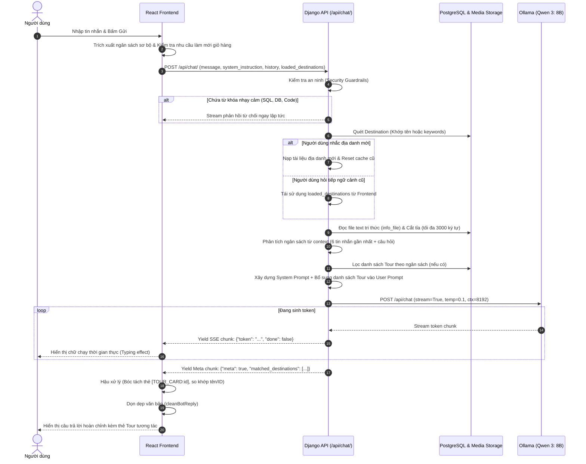
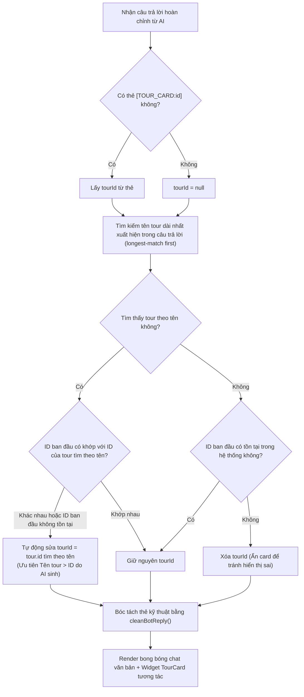

# 🤖 TÀI LIỆU KỸ THUẬT VỀ TÍNH NĂNG AI CHATBOT — TRAVELBAMIA

Tài liệu này cung cấp cái nhìn chi tiết và toàn diện về tính năng **AI Chatbot** trong dự án **TravelBaMia**: từ kiến trúc tổng thể, cơ chế thu thập dữ liệu (Data Ingestion), quy trình xử lý truy vấn kết hợp RAG (Retrieval-Augmented Generation), suy luận và streaming token thời gian thực, cho đến các cơ chế xử lý hậu kỳ và tương tác giao diện người dùng.

---

## 📑 MỤC LỤC
1. [Tổng Quan Kiến Trúc (Architecture Overview)](#1-tổng-quan-kiến-trúc-architecture-overview)
2. [Quy Trình Xử Lý Từ Đầu Đến Cuối (End-to-End Workflow)](#2-quy-trình-xử-lý-từ-đầu-đến-cuối-end-to-end-workflow)
3. [Thu Thập & Chuẩn Bị Dữ Liệu Ngữ Cảnh (Context Ingestion)](#3-thu-thập--chuẩn-bị-dữ-liệu-ngữ-cảnh-context-ingestion)
4. [Cơ Chế RAG & Quản Lý Tri Thức Địa Điểm (Knowledge Base)](#4-cơ-chế-rag--quản-lý-tri-thức-địa-điểm-knowledge-base)
5. [Cơ Chế Nhận Diện & Phân Tích Ngân Sách Tự Nhiên (Budget Parsing)](#5-cơ-chế-nhận-diện--phân-tích-ngân-sách-tự-nhiên-budget-parsing)
6. [Kỹ Thuật Chống Thiên Vị Gần (Recency Bias Mitigation)](#6-kỹ-thuật-chống-thiên-vị-gần-recency-bias-mitigation)
7. [Cơ Chế An Toàn & Bảo Mật (Guardrails & Security)](#7-cơ-chế-an-toàn--bảo-mật-guardrails--security)
8. [Cơ Chế Streaming & Đồng Bộ Siêu Dữ Liệu (SSE & Meta Chunking)](#8-cơ-chế-streaming--đồng-bộ-siêu-dữ-liệu-sse--meta-chunking)
9. [Cơ Chế Tự Phục Hồi & Ghép Nối Thẻ Tour (UI Card Self-Correction)](#9-cơ-chế-tự-phục-hồi--ghép-nối-thẻ-tour-ui-card-self-correction)
10. [Quản Lý Vòng Đời & Phiên Làm Việc (Session & Memory Lifecycle)](#10-quản-lý-vòng-đời--phiên-làm-việc-session--memory-lifecycle)
11. [Giám Sát Trạng Thái & Khả Năng Chịu Lỗi (Health & Fallback)](#11-giám-sát-trạng-thái--khả-năng-chịu-lỗi-health--fallback)
12. [Bản Đồ Tệp Tin Mã Nguồn (Codebase Mapping)](#12-bản-đồ-tệp-tin-mã-nguồn-codebase-mapping)

---

## 1. Tổng Quan Kiến Trúc (Architecture Overview)

Tính năng AI Chatbot của TravelBaMia được thiết kế theo mô hình **Hybrid Architecture** kết hợp giữa **Local LLM Engine** và **Backend Orchestrator**:

- **Mô hình AI:** Chạy hoàn toàn cục bộ thông qua **Ollama** với model **`Qwen 3: 8B`**, không phụ thuộc vào dịch vụ cloud trả phí (OpenAI/Anthropic), đảm bảo quyền riêng tư dữ liệu và độ trễ tối ưu.
- **Backend Orchestrator (Django REST Framework):** Đóng vai trò làm bộ não trung gian chịu trách nhiệm: xác thực JWT, phân tích ngữ cảnh, kích hoạt pipeline RAG, lọc ngân sách, kiểm duyệt an toàn, gọi suy luận LLM và stream kết quả.
- **Frontend Client (React 19 + Vite):** Đảm nhiệm việc quản lý trạng thái phiên chat, tiêu thụ stream SSE theo thời gian thực, tự động giải mã các thẻ chỉ lệnh và render các widget UI động (Interactive Tour Cards).

```
+---------------------------------------------------------------------------------------+
|                                    REACT FRONTEND                                     |
|  - AuthContext (JWT Token)            - useStreamChat (SSE Reader)                    |
|  - ChatbotUtils (Budget & Prompt)     - ChatbotMessages & TourCard                    |
+-------------------+-----------------------------------------------+-------------------+
                    |                                               ^
     1. Post Message| (Text + History + Loaded Cache)               | 8. SSE Streaming
                    v                                               |    Tokens & Meta
+-------------------------------------------------------------------+-------------------+
|                            DJANGO REST BACKEND (ChatbotAPIView)                       |
|  +---------------------------------------------------------------------------------+  |
|  | [1] Security Guardrails (Ngăn chặn SQL Injection / Prompt Injection)           |  |
|  | [2] Entity Recognition: Khớp tên & keywords của Destination                    |  |
|  | [3] Multi-turn Context Resolution: Kích hoạt / Cập nhật loaded_destinations     |  |
|  | [4] Budget Extraction: Regex nhận diện ngân sách (triệu, k, số phân cách)       |  |
|  | [5] RAG Retrieval: Đọc file .txt tri thức địa điểm từ thư mục media             |  |
|  | [6] System Prompt & Recency Injection: Dựng lại prompt có <DANH_SACH_TOUR>      |  |
|  +---------------------------------------------------------------------------------+  |
+-------------------+-----------------------------------------------+-------------------+
                    |                                               ^
     6. HTTP POST   | (Prompt + History + Options)                  | 7. Token Chunks
                    v                                               |    (stream=True)
+-------------------------------------------------------------------+-------------------+
|                                 OLLAMA LOCAL LLM ENGINE                               |
|   Endpoint: http://127.0.0.1:11434/api/chat                                           |
|   Model: qwen3:8b | temp: 0.1 | ctx: 8192 | top_k: 20 | top_p: 0.8                   |
+---------------------------------------------------------------------------------------+
```

---

## 2. Quy Trình Xử Lý Từ Đầu Đến Cuối (End-to-End Workflow)

Quá trình từ lúc người dùng gửi tin nhắn đến khi nhận câu trả lời diễn ra theo trình tự 8 bước chặt chẽ:



---

## 3. Thu Thập & Chuẩn Bị Dữ Liệu Ngữ Cảnh (Context Ingestion)

### 3.1. Thu thập dữ liệu đa nguồn phía Frontend
Khi người dùng mở khung chat (`isOpen = true`) và đã đăng nhập:
- Frontend thực hiện truy vấn đồng thời bằng `Promise.allSettled`:
  1. `api.get("tours/")`: Lấy danh mục toàn bộ các tour đang mở bán.
  2. `api.get("chat/health/")`: Kiểm tra trạng thái sẵn sàng của dịch vụ Ollama.
  3. `api.get("bookings/")` & `api.get("cart/")`: Lấy lịch sử đặt tour và giỏ hàng của chính tài khoản đang đăng nhập.
- Dữ liệu này được chuyển hóa thành thẻ định dạng XML có cấu trúc chặt chẽ thông qua hàm `buildSystemPrompt`:

```xml
<DANH_SACH_TOUR>
<TOUR id="1" ten="Khám Phá Sapa 3N2Đ" dia_diem="Lào Cai" gia="3.500.000" />
<TOUR id="2" ten="Tour Đà Lạt Mộng Mơ" dia_diem="Lâm Đồng" gia="2.200.000" />
</DANH_SACH_TOUR>
```

### 3.2. Cơ chế "Auto-refresh on Intent"
Trước khi gửi mỗi tin nhắn, Frontend phân tích nội dung câu hỏi của người dùng. Nếu phát hiện các từ khóa liên quan đến trạng thái giỏ hàng hoặc giao dịch:
```javascript
const needsRefresh = /giỏ hàng|đơn hàng|booking|kiểm tra|cập nhật/i.test(userText);
```
Frontend sẽ tự động gọi lại API để làm mới thông tin giỏ hàng và danh sách đặt chỗ mới nhất từ cơ sở dữ liệu trước khi gửi câu hỏi tới AI, đảm bảo AI luôn nắm bắt chính xác tình trạng tài khoản của khách mà không cần reload trang.

---

## 4. Cơ Chế RAG & Quản Lý Tri Thức Địa Điểm (Knowledge Base)

Hệ thống triển khai pipeline **RAG (Retrieval-Augmented Generation)** gọn nhẹ, hiệu quả cao dựa trên cấu trúc tệp tri thức cục bộ:

### 4.1. Cấu trúc dữ liệu tri thức địa điểm (`Destination`)
Tại `travel-backend/tours/models.py`:
- `name`: Tên địa danh (ví dụ: *"Đà Lạt"*, *"Sapa"*, *"Hà Giang"*).
- `keywords`: Danh sách từ khóa liên quan, phân tách bằng dấu phẩy (ví dụ: *"thành phố sương mù, cao nguyên, xứ ngàn hoa"*).
- `info_file`: File định dạng văn bản thô (`.txt`) được lưu trong `destinations/info/`, chứa toàn bộ cẩm nang chi tiết: thời tiết, điểm tham quan, ẩm thực đặc trưng, văn hóa địa phương và kinh nghiệm du lịch.

### 4.2. Hệ thống CMS Quản lý Tri thức dành cho Quản trị viên
Hệ thống cung cấp hai API chuyên biệt tại `travel-backend/core/views.py`:
- `admin_get_destination_info(request, pk)`: Đọc trực tiếp nội dung file `.txt` và danh sách từ khóa để hiển thị lên giao diện Admin.
- `admin_update_destination_info(request, pk)`: Cho phép Quản trị viên cập nhật hoặc bổ sung tài liệu tri thức cho địa danh ngay trên web quản trị. Hệ thống tự động ghi đè file trên đĩa hoặc tạo file mới thông qua Django `ContentFile`.

### 4.3. Quy trình RAG tại `ChatbotAPIView`
Khi người dùng gửi câu hỏi:
1. **Quét từ khóa & Thực thể (Entity Matching):** So khớp tên địa danh (`dest.name.lower() in msg_lower`) hoặc các từ khóa phụ (`dest.keywords.split(',')`).
2. **Xử lý hội thoại nối tiếp (Multi-turn Follow-up Resolution):**
   - *Trường hợp 1 (Nhắc địa danh mới):* Nếu câu hỏi có nhắc tên/từ khóa địa danh cụ thể (ví dụ: *"Tôi muốn đi Đà Lạt"*), hệ thống chọn địa danh đó làm ngữ cảnh active, đồng thời **xóa sạch cache cũ** để tránh làm phình Context Window.
   - *Trường hợp 2 (Hỏi tiếp ngữ cảnh cũ):* Nếu người dùng hỏi các câu gián tiếp không nhắc tên (ví dụ: *"Ở đó có đặc sản gì ngon?", "Thời tiết tháng này thế nào?"*), hệ thống kích hoạt lại danh sách địa danh từ `loaded_destinations` mà Frontend gửi lên.
3. **Trích xuất & Cắt tỉa (Content Trimming):**
   - Đọc file `.txt` tương ứng.
   - Để bảo vệ Context Window của LLM cục bộ, hệ thống **cắt ngắn tối đa 3,000 ký tự** cho mỗi địa danh:
     ```python
     if len(content) > 3000:
         content = content[:3000] + "\n...(còn tiếp)"
     ```
   - Đóng gói nội dung vào khối RAG:
     ```text
     === DỮ LIỆU ĐỊA ĐIỂM: [Tên địa điểm] ===
     [Nội dung cẩm nang du lịch...]
     ```

---

## 5. Cơ Chế Nhận Diện & Phân Tích Ngân Sách Tự Nhiên (Budget Parsing)

Để hỗ trợ khách hàng tìm tour theo ngân sách nhanh chóng, dự án xây dựng bộ parser xử lý ngôn ngữ tự nhiên kép (chạy độc lập tại cả Frontend `ChatbotUtils.js` và Backend `_extract_budget`):

### 5.1. Các dạng thức ngân sách được hỗ trợ
Hệ thống nhận diện 3 mẫu biểu đạt phổ biến trong tiếng Việt:
1. **Dạng số đầy đủ có phân cách:** `"2.000.000"`, `"2,500,000"`, `"3000000 đồng"`, `"1500000 vnđ"`.
2. **Dạng viết theo đơn vị triệu:** `"2 triệu"`, `"2.5 triệu"`, `"khoảng 1,8 tr"`.
3. **Dạng viết tắt nghìn / k:** `"500k"`, `"300 nghìn"`, `"200 ngàn"`.

### 5.2. Quét ngữ cảnh đa lượt (Multi-turn Budget Context)
Bộ parser không chỉ quét tin nhắn hiện tại mà kiểm tra toàn bộ ngữ cảnh gồm **6 tin nhắn lịch sử gần nhất + tin nhắn hiện tại**:
```python
full_context_for_budget = " ".join(
    [msg.get("content", "") for msg in history[-6:]] + [user_message]
)
max_budget = _extract_budget(full_context_for_budget)
```
*Lợi ích:* Nếu ở tin nhắn trước khách nói *"Ngân sách của tôi tầm 3 triệu"*, và ở tin nhắn sau hỏi *"Có tour nào đi biển không?"*, hệ thống vẫn ghi nhớ và tự động áp dụng bộ lọc `price <= 3,000,000 VNĐ`.

### 5.3. Ràng buộc cứng (Hard Constraint Injection)
Khi phát hiện ngân sách tối đa:
- Backend lọc trực tiếp danh sách Tour trong database: `Tour.objects.filter(price__lte=max_budget)`.
- Chèn chỉ lệnh ưu tiên cao vào Prompt:
  > *"QUAN TRỌNG: Khách yêu cầu ngân sách tối đa X VNĐ. CHỈ được gợi ý các tour có trong `<DANH_SACH_TOUR>` bên dưới (đã được lọc theo ngân sách)."*

---

## 6. Kỹ Thuật Chống Thiên Vị Gần (Recency Bias Mitigation)

Các mô hình ngôn ngữ vừa và nhỏ (SLM/LLM 8B) thường gặp hiện tượng **"Lost in the Middle"** hoặc **"Recency Bias"** (chỉ chú ý phần nội dung nằm ở cuối cùng của prompt và quên mất System Instruction ở đầu).

Để khắc phục triệt để, hệ thống áp dụng kỹ thuật **Dual Context Re-injection**:
Khi có dữ liệu RAG về địa điểm, Backend không chỉ đưa vào System Prompt mà còn đóng gói toàn bộ danh sách tour vào ngay trong nội dung của **User Message cuối cùng**:

```text
1. THÔNG TIN ĐỊA ĐIỂM (Không phải tour):
=== DỮ LIỆU ĐỊA ĐIỂM: Sapa ===
... [cẩm nang thời tiết, thắng cảnh] ...

2. DANH SÁCH TOUR TRONG HỆ THỐNG:
<DANH_SACH_TOUR>
<TOUR id="8" ten="Khám Phá Bản Cát Cát" dia_diem="Lào Cai" gia="1.200.000" />
</DANH_SACH_TOUR>

CÂU HỎI CỦA KHÁCH: Tư vấn cho tôi tour đi Sapa 2 ngày.

(Gợi ý cho AI: Nếu khách hỏi tour, HÃY TÌM TRONG DANH SÁCH TOUR TRONG HỆ THỐNG. KHÔNG lấy thông tin địa điểm làm tour. Tuân thủ định dạng thẻ [TOUR_CARD:ID] ở Quy tắc Bắt buộc.)
```
Nhờ cơ chế này, AI phân biệt rạch ròi giữa **thông tin thắng cảnh/địa điểm** (dùng để trả lời câu hỏi tìm hiểu) và **danh sách tour có thể đặt** (dùng để tư vấn tour).

---

## 7. Cơ Chế An Toàn & Bảo Mật (Guardrails & Security)

Hệ thống áp dụng nhiều lớp phòng thủ để ngăn chặn lạm dụng và rò rỉ dữ liệu:

1. **Xác thực JWT Bắt buộc:** Endpoint `/api/chat/` yêu cầu quyền `IsAuthenticated`. Chỉ người dùng đã đăng nhập mới có thể trò chuyện với AI.
2. **Bộ lọc từ khóa nhạy cảm (Prompt Injection Defense):**
   Backend kiểm tra tin nhắn với danh sách từ khóa cấm:
   ```python
   security_keywords = [
       'database', 'password', 'mật khẩu', 'cấu trúc sql',
       'select *', 'delete from', 'drop table', 'backend code'
   ]
   ```
   Nếu phát hiện, hệ thống phản hồi từ chối ngay lập tức mà không chuyển tiếp tới LLM:
   > *"Xin lỗi, tôi không thể hỗ trợ các thông tin liên quan đến kỹ thuật hoặc bảo mật hệ thống. 🙏"*
3. **Giới hạn Lịch sử (Sliding Context Window):** Chỉ gửi tối đa 10 tin nhắn gần nhất (`history[-10:]`), giúp tiết kiệm token, ngăn ngừa tràn bộ nhớ và hạn chế rủi ro jailbreak qua lịch sử dài.
4. **Tham số Temperature thấp (`0.1`):** Giữ mức sáng tạo của mô hình ở mức tối thiểu để câu trả lời bám sát dữ liệu thực tế, triệt tiêu ảo giác (hallucination).

---

## 8. Cơ Chế Streaming & Đồng Bộ Siêu Dữ Liệu (SSE & Meta Chunking)

Nhằm mang lại trải nghiệm tương tác tự nhiên như người thật đang gõ, hệ thống sử dụng cơ chế Server-Sent Events (SSE):

### 8.1. Generator tại Backend
Hàm `_stream_ollama` gọi endpoint `/api/chat` của Ollama với `stream=True`. Khi Ollama sinh từng token, Backend lập tức yield ra client dưới dạng dòng JSON:
```json
{"token": "Xin", "done": false}
{"token": " chào", "done": false}
```

### 8.2. Meta Chunking đồng bộ trạng thái Cache
Sau khi toàn bộ nội dung văn bản đã hoàn tất (`done: true`), generator tại Backend gửi thêm **1 chunk siêu dữ liệu đặc biệt (Meta Chunk)** trước khi đóng kết nối:
```json
{"meta": true, "matched_destinations": ["Đà Lạt"]}
```
Khi Frontend nhận chunk này, nó cập nhật state `loadedDestinations` để chuẩn bị cho lượt chat tiếp theo của người dùng.

### 8.3. Header cấu hình chống đệm (No-Buffering Headers)
Để đảm bảo các proxy (như Nginx) hoặc trình duyệt không gom cụm gói tin làm mất hiệu ứng gõ chữ, Backend thiết lập:
```python
response = StreamingHttpResponse(stream_with_retry(), content_type='text/event-stream; charset=utf-8')
response['Cache-Control'] = 'no-cache'
response['X-Accel-Buffering'] = 'no'
```

---

## 9. Cơ Chế Tự Phục Hồi & Ghép Nối Thẻ Tour (UI Card Self-Correction)

Một thách thức lớn khi dùng Local LLM (8B) là mô hình thường viết đúng tên tour trong bài viết nhưng thỉnh thoảng lại tạo nhầm `id` trong thẻ `[TOUR_CARD:id]`. TravelBaMia giải quyết vấn đề này bằng thuật toán **Self-Correction** tại Frontend:



### 9.1. Làm sạch văn bản (`cleanBotReply`)
Trước khi hiển thị tin nhắn lên giao diện, các thẻ điều khiển nội bộ như `[TOUR_CARD:12]`, `[ESCALATE]`, `[TASK_COMPLETE]` sẽ được loại bỏ hoàn toàn bằng Regex, giúp nội dung hiển thị trong sáng và thân thiện với người dùng.

### 9.2. Cơ chế Chuyển tiếp Hỗ trợ Khách hàng (Human Escalation)
Nếu khách hàng gặp sự cố phức tạp hoặc AI phát hiện cần hỗ trợ trực tiếp, hệ thống hỗ trợ chỉ lệnh `[ESCALATE]`. Khi cờ này được kích hoạt, giao diện chat hiển thị 2 tùy chọn nhanh:
- **Tiếp tục với AI:** Tiếp tục hội thoại tự động.
- **Gặp nhân viên:** Điều hướng ngay lập tức đến trang Liên hệ hỗ trợ (`/contact`).

---

## 10. Quản Lý Vòng Đời & Phiên Làm Việc (Session & Memory Lifecycle)

- **Lưu trữ cục bộ (LocalStorage):** Cuộc trò chuyện được lưu tạm trong `localStorage` với khóa `travel_bamia_chat_history` để người dùng không bị mất nội dung khi lỡ chuyển trang.
- **Cơ chế tự hủy sau 30 phút (TTL - Time to Live):**
  ```javascript
  export const CHAT_EXPIRY_MS = 30 * 60 * 1000; // 30 phút
  ```
  Nếu khoảng cách thời gian giữa lần tương tác cuối và thời điểm mở web vượt quá 30 phút, toàn bộ lịch sử sẽ tự động bị xóa sạch để bảo vệ quyền riêng tư.
- **Xóa sạch khi Đăng xuất (Auth Boundary):** Ngay khi người dùng đăng xuất, toàn bộ tin nhắn, context, cache địa điểm và bản ghi lưu trữ đều bị hủy hoàn toàn.
- **Xóa chủ động:** Người dùng có thể nhấn nút biểu tượng Thùng rác trên thanh Header của Chatbot để dọn sạch toàn bộ ngữ cảnh bất cứ lúc nào.

---

## 11. Giám Sát Trạng Thái & Khả Năng Chịu Lỗi (Health & Fallback)

### 11.1. Health Check Endpoint (`/api/chat/health/`)
Lớp `OllamaHealthView` kiểm tra định kỳ kết nối tới Ollama:
- Nếu Ollama đang chạy: trả về `status: 'ok'`.
- Nếu Ollama chưa bật: trả về `status: 'offline'` (HTTP 503).
- Nếu phản hồi chậm quá 5 giây: trả về `status: 'timeout'`.

### 11.2. Phản hồi trực quan trên giao diện (Visual Feedback)
- **Chấm trạng thái:** Đèn xanh (AI sẵn sàng) hoặc đèn đỏ (AI offline) trên Avatar của Chatbot Header.
- **Banner cảnh báo:** Nếu AI đang offline, một banner thông báo màu đỏ hiển thị: *"AI đang offline. Chạy `ollama serve` để bật"* kèm nút **"Thử lại"** để kích hoạt kiểm tra lại mà không cần tải lại trang.

### 11.3. Cơ chế Tự động Thử lại (Auto-Retry Mechanism)
Trong quá trình stream câu trả lời, nếu xảy ra lỗi kết nối tạm thời (`ConnectionError`), hàm `stream_with_retry()` tại Backend sẽ tự động thử lại tối đa 2 lần (`OLLAMA_MAX_RETRIES = 2`) với thời gian trễ 1 giây trước khi báo lỗi cho người dùng.

---

## 12. Bản Đồ Tệp Tin Mã Nguồn (Codebase Mapping)

Dưới đây là các tệp tin cấu thành toàn bộ tính năng Chatbot trong dự án:

| Tầng | Đường dẫn tệp tin | Chức năng chính |
|---|---|---|
| **Backend** | `travel-backend/chatbot/views.py` | Controller chính: Xử lý RAG, trích xuất ngân sách, streaming SSE, bảo mật, health check |
| **Backend** | `travel-backend/tours/models.py` | Model `Destination` (chứa `keywords` và `info_file`) & Model `Tour` |
| **Backend** | `travel-backend/core/views.py` | API quản trị nội dung tri thức địa danh (`admin_get/update_destination_info`) |
| **Backend** | `travel-backend/chatbot/ml/` | Bộ phân loại ý định (TF-IDF + ML), dịch vụ suy luận singleton, benchmark, retrain |
| **Backend** | `travel-backend/chatbot/models.py` | Model `IntentLog` lưu trữ nhật ký phân loại phục vụ vòng phản hồi |
| **Backend** | `travel-backend/core/urls.py` | Cấu hình định tuyến `/api/chat/`, `/api/chat/health/`, `/api/chat/feedback/` |
| **Backend** | `travel-backend/chatbot/tests.py` | Bộ kiểm thử tự động 26 test cases: ngân sách, chuẩn hóa tiếng Việt, định tuyến, bảo mật, gate |
| **Frontend** | `travel-frontend/src/components/Chatbot.jsx` | Component giao diện Chatbot tổng, điều phối logic và lưu trữ phiên |
| **Frontend** | `travel-frontend/src/components/chatbox/useStreamChat.js` | Custom Hook quản lý kết nối SSE, giải mã Stream và Meta Chunks |
| **Frontend** | `travel-frontend/src/components/chatbox/ChatbotUtils.js` | Các tiện ích: `buildSystemPrompt`, `cleanBotReply`, `parseBudget`, `filterToursByBudget` |
| **Frontend** | `travel-frontend/src/components/chatbox/ChatbotMessages.jsx` | Hiển thị danh sách tin nhắn, hiệu ứng gõ chữ, nút hỗ trợ và phản hồi 👍/👎 |
| **Frontend** | `travel-frontend/src/components/chatbox/TourCard.jsx` | Thẻ tour tương tác hiển thị hình ảnh, giá và nút điều hướng chi tiết |
| **Frontend** | `travel-frontend/src/components/chatbox/ChatbotInput.jsx` | Ô nhập liệu thông minh tự vô hiệu hóa khi AI offline hoặc đang tải |
| **Frontend** | `travel-frontend/src/components/chatbox/ChatbotHeader.jsx` | Thanh tiêu đề hiển thị chấm trạng thái AI và nút xóa lịch sử |
| **Frontend** | `travel-frontend/src/components/chatbox/StatusBanner.jsx` | Banner cảnh báo trạng thái ngoại tuyến của Ollama |

---

## 13. Bộ Phân Loại Ý Định (Machine Learning) & Vòng Phản Hồi

Để nâng cấp hệ thống từ luật cứng sang học máy tự huấn luyện và đáp ứng yêu cầu đồ án môn *"Phát triển các Hệ thống Thông minh"*, Chatbot TravelBaMia đã tích hợp bộ phân loại ý định 6 nhãn đứng trước LLM kèm vòng phản hồi liên tục.

Chi tiết toàn bộ kiến trúc, hướng dẫn vận hành, khung kết quả và phân tích đạo đức được lưu trữ tại thư mục **`docs/ml/`**:
- [00_survey.md](file:///docs/ml/00_survey.md): Khảo sát hiện trạng mã nguồn nền tảng trước khi tích hợp.
- [01_architecture.md](file:///docs/ml/01_architecture.md): Sơ đồ Mermaid luồng định tuyến yêu cầu và chu trình phản hồi người dùng.
- [02_how_to_run.md](file:///docs/ml/02_how_to_run.md): Hướng dẫn thực thi từng bước (validate -> train -> baseline -> benchmark -> retrain).
- [03_results_TEMPLATE.md](file:///docs/ml/03_results_TEMPLATE.md): Khung bảng kết quả chuẩn hóa cho báo cáo đồ án.
- [04_ethics_tradeoffs.md](file:///docs/ml/04_ethics_tradeoffs.md): Quyền riêng tư của log, chống đầu độc dữ liệu và các đánh đổi kỹ thuật.

---

> 💡 **Tóm lại:** Tính năng Chatbot trong TravelBaMia không đơn thuần là gọi một API LLM thông thường, mà là một **hệ thống hoàn chỉnh** bao gồm: Bộ phân loại ý định học máy (TF-IDF + ML), RAG tri thức cục bộ, xử lý ngôn ngữ tự nhiên hiểu ngân sách người Việt, phòng thủ an ninh đa tầng, đồng bộ trạng thái ngữ cảnh đa lượt, tự phục hồi lỗi mô hình, tương tác giao diện thẻ động thời gian thực và vòng phản hồi cải thiện liên tục (Feedback Loop).

