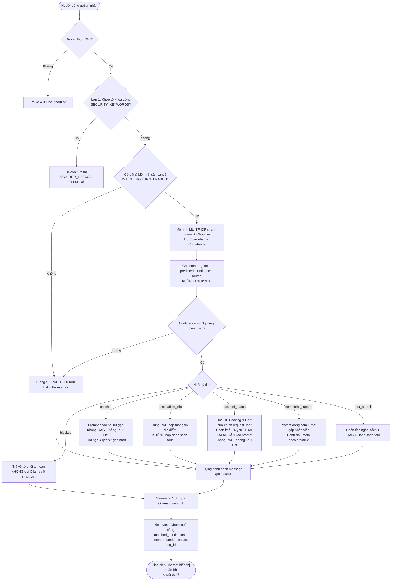

# Kiến trúc Bộ phân loại Ý định & Vòng phản hồi (TravelBaMia Chatbot)

Tài liệu này mô tả chi tiết kiến trúc của bộ phân loại ý định (học máy) đứng trước LLM và cơ chế vòng phản hồi (feedback loop) cải thiện liên tục cho Chatbot TravelBaMia.

---

## 1. Sơ đồ luồng xử lý tin nhắn (Request Processing Flow)

---

## 2. Sơ đồ Vòng phản hồi cải thiện mô hình (Feedback Loop & Retraining)

```mermaid
flowchart LR
    subgraph Client [Người dùng tương tác]
        BotMsg[Tin nhắn phản hồi từ Bot] --> Thumbs[Người dùng bấm 👍 hoặc 👎]
        Thumbs --> APICall[POST /api/chat/feedback/\nlog_id & feedback]
    end

    subgraph Backend [Backend & Quản trị]
        APICall --> Throttle[ScopedRateThrottle\n30 req/min]
        Throttle --> UpdateDB[(Cập nhật IntentLog\nfeedback = +1 / -1\nChỉ cập nhật 1 lần)]
        UpdateDB --> AdminReview[Admin kiểm tra IntentLog\nLọc câu confidence thấp hoặc bị 👎]
        AdminReview --> AdminLabel[Admin gán corrected_label\nqua action hàng loạt]
    end

    subgraph RetrainPipeline [Huấn luyện lại có kiểm soát]
        ExportCmd[Command export_intent_feedback] --> CleanData[CSV phản hồi đã duyệt\nKhử trùng lặp]
        CleanData --> MergeData[Gộp intents.csv gốc + CSV phản hồi]
        MergeData --> TrainCandidate[Huấn luyện ứng viên mới\nStratified 5-Fold so sánh 4 thuật toán]
        TrainCandidate --> EvalBoth[Đánh giá đối đầu trên golden.csv\nMô hình cũ VS Ứng viên mới]
        EvalBoth --> GateCheck{Cổng chất lượng:\nMacro-F1 >= cũ VÀ\nBlocked Recall không giảm?}

        GateCheck -- Không đạt --> Reject[Từ chối thay thế\nGiữ nguyên mô hình cũ\nLưu báo cáo phân tích]
        GateCheck -- Đạt --> BackupOld[Sao lưu mô hình cũ\nvào artifacts/backup/ kèm timestamp]
        BackupOld --> ReplaceModel[Ghi đè intent_model.pkl\nSinh báo cáo JSON/MD]
        ReplaceModel --> AutoReload[IntentService tự động reload\nnhờ kiểm tra st_mtime]
    end

    AdminLabel -.-> ExportCmd
```

---

## 3. Các đặc điểm kiến trúc then chốt

1. **Phòng thủ đa tầng (Defense in Depth)**:
   - *Lớp 1*: Bộ lọc từ khóa nguy hiểm (`SECURITY_KEYWORDS`) ngăn chặn các câu tấn công SQL, xem mã nguồn trực tiếp mà không tốn chi phí tính toán.
   - *Lớp 2*: Bộ phân loại học máy TF-IDF char n-grams nhận diện các biến thể câu hỏi kỹ thuật / phá hoại / vượt quyền (`blocked`).
   - *Lớp 3*: Ngưỡng tin cậy theo nhãn (Thresholding) ngăn chặn việc định tuyến nhầm khi mô hình phân vân.

2. **Tương thích ngược 100%**:
   - Định dạng SSE token không thay đổi: `{"token": "...", "done": false}`.
   - Meta chunk chỉ bổ sung các trường: `intent`, `intent_confidence`, `routed`, `escalate`, `log_id`. Consumer cũ bỏ qua các trường lạ mà không gặp lỗi.
   - Cờ `INTENT_ROUTING_ENABLED` khi tắt hoặc khi file `.pkl` bị thiếu sẽ đưa hệ thống về luồng cũ nguyên vẹn.

3. **Mô hình Singleton & Hot Reload**:
   - `IntentService` nạp `.pkl` vào RAM một lần duy nhất lúc khởi động.
   - Khi `retrain_intent` ghi đè file mô hình, `IntentService.reload_if_changed()` phát hiện `st_mtime` thay đổi và nạp lại trong thread-safe lock mà không cần khởi động lại tiến trình server.

4. **Bảo mật dữ liệu tuyệt đối (Zero-Knowledge Logging)**:
   - `IntentLog` chỉ ghi 500 ký tự văn bản, nhãn dự đoán, điểm tin cậy và trạng thái định tuyến.
   - Tuyệt đối **không** lưu user ID, IP address, session ID, thông tin thẻ hay thông tin cá nhân.
